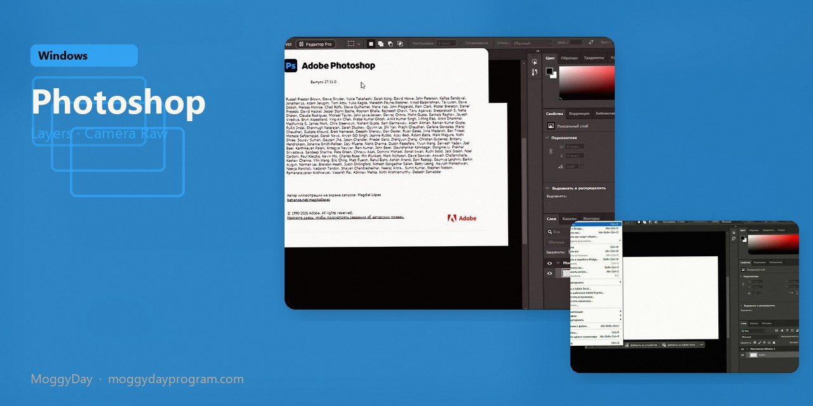
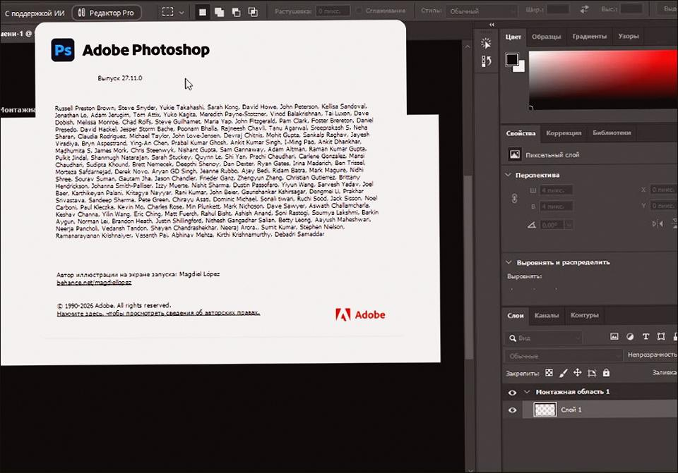
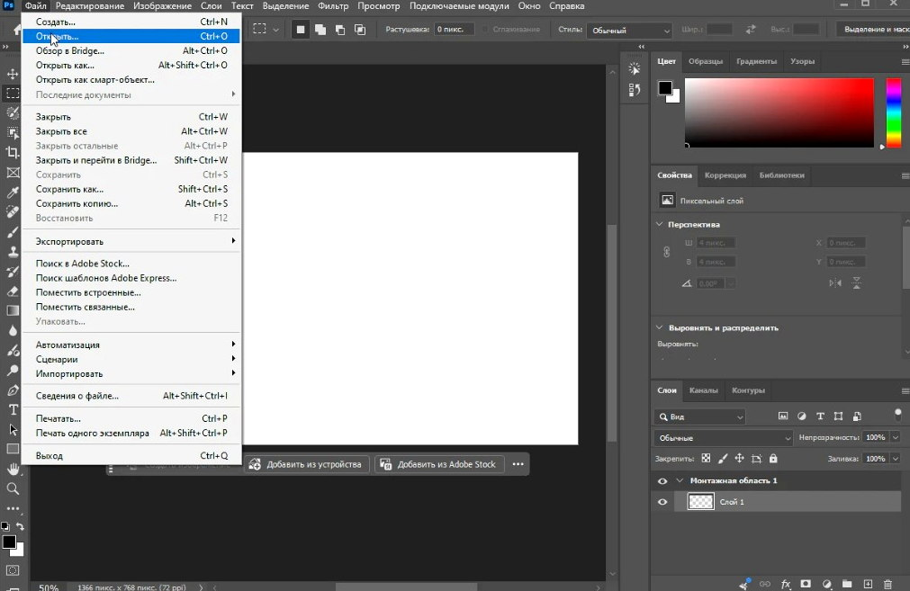
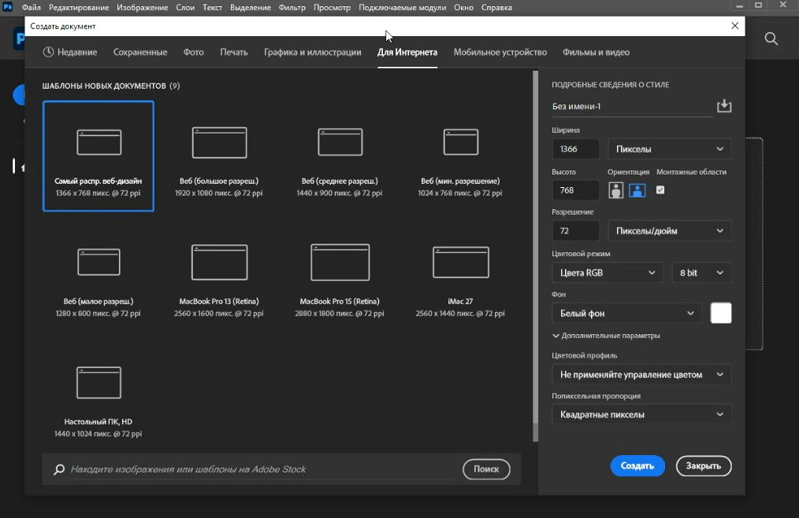

# Adobe Photoshop 2026 v27.11 for Windows — MoggyDay

**Language / Язык:** the [GitHub Pages site](https://soldermofitting.github.io/adobe-photoshop-windows/) picks English or Russian from the browser. Switch: [English](https://soldermofitting.github.io/adobe-photoshop-windows/?lang=en) · [Русский](https://soldermofitting.github.io/adobe-photoshop-windows/?lang=ru)

  

Adobe Photoshop · MoggyDay · 2026 · v27.11

# Adobe Photoshop 2026 “for Windows: Camera Raw, Neural Filters, Russian UI” [v27.11]

  
  
  

MoggyDay keeps one stable URL for Adobe Photoshop: EN / RU. Build 2026 v27.11 is the raster editor on the card — layers, masks, Camera Raw, Neural Filters.

## Download

1. Open [Adobe Photoshop 2026 EN](https://moggydayprogram.com/en/programs/adobe-photoshop) or [Adobe Photoshop 2026 RU](https://moggydayprogram.com/programs/adobe-photoshop).
2. Stay on moggydayprogram.com.
3. Use the primary button on that card. Prefer [MoggyDay Launcher](https://moggydayprogram.com/launcher) if the archive is large.
4. After a catalog update, reload the same Photoshop URL.

## Official links

| | URL |
| --- | --- |
| EN | https://moggydayprogram.com/en/programs/adobe-photoshop |
| RU | https://moggydayprogram.com/programs/adobe-photoshop |
| Adobe | https://moggydayprogram.com/collections/adobe |
| Graphics | https://moggydayprogram.com/categories/graphics |
| Catalog | https://moggydayprogram.com/programs |
| Launcher | https://moggydayprogram.com/launcher |

## More programs on MoggyDay

- [Adobe Illustrator](https://moggydayprogram.com/programs/adobe-illustrator)
- [Adobe Premiere Pro](https://moggydayprogram.com/programs/adobe-premiere-pro)
- [Adobe After Effects](https://moggydayprogram.com/programs/adobe-after-effects)
- [CorelDRAW](https://moggydayprogram.com/programs/coreldraw)
- [Microsoft Office](https://moggydayprogram.com/programs/microsoft-office)

Canonical: https://moggydayprogram.com/programs/adobe-photoshop  
GitHub Pages: https://soldermofitting.github.io/adobe-photoshop-windows/  
No installer on this repo — packages live on the catalog site.
